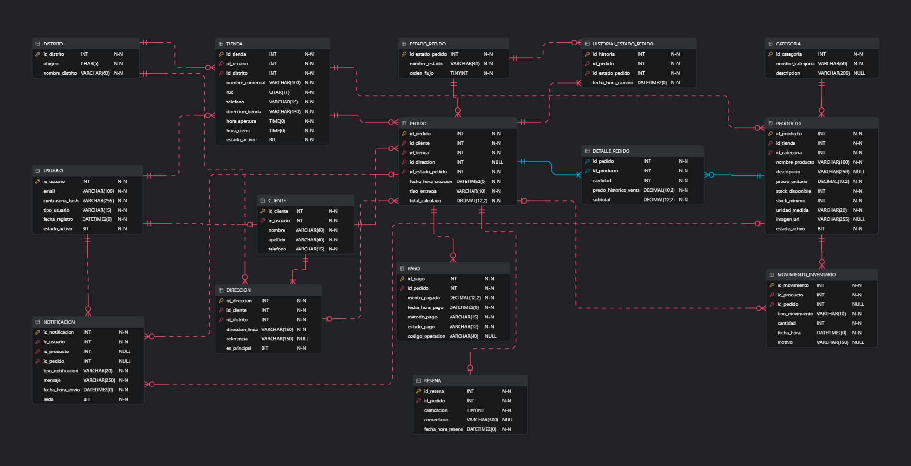

# WasiMarketAPI

[](https://dotnet.microsoft.com/)
[](https://learn.microsoft.com/dotnet/csharp/)
[](https://www.microsoft.com/sql-server)
[](https://learn.microsoft.com/ef/core/)
[](https://github.com/DapperLib/Dapper)
[](https://swagger.io/)

API REST desarrollada en **ASP.NET Core (.NET 8)** para la administración del catálogo de productos y el flujo transaccional de un carrito de compras sobre la base de datos relacional **WasiMarketDB**. 

El proyecto adopta un patrón de **persistencia híbrida**, aprovechando la robustez de un **ORM (Entity Framework Core)** para validaciones y mutaciones de datos, junto con el rendimiento de un **MicroORM (Dapper)** para consultas de lectura de baja latencia. El estado transaccional del carrito en memoria se administra mediante estructuras de datos optimizadas (`Dictionary`, `HashSet` y `List`).

---

## Modelo Físico de Base de Datos

El esquema relacional consta de 15 tablas normalizadas con restricciones de integridad referencial, índices filtrados y reglas de negocio a nivel de motor:



### Módulos del Sistema
* **Actores y Ubicaciones:** Tablas `USUARIO`, `CLIENTE`, `TIENDA`, `DISTRITO` y `DIRECCION`. Soporta segregación por tipo de usuario (`COMERCIANTE`, `CONSUMIDOR`), control de ubigeo y regla de dirección principal única por cliente.
* **Catálogo y Existencias:** Tablas `CATEGORIA`, `PRODUCTO` y `MOVIMIENTO_INVENTARIO`. Controla stock disponible, alertas de stock mínimo, validación de unidades (`UNIDAD`, `KILOGRAMO`, `LITRO`, `PAQUETE`) y trazabilidad de entradas/salidas/mermas.
* **Pedidos y Transacciones:** Tablas `PEDIDO`, `DETALLE_PEDIDO`, `ESTADO_PEDIDO`, `HISTORIAL_ESTADO_PEDIDO` y `PAGO`. Incluye columna persistida calculada para el subtotal (`cantidad * precio_historico_venta`) y seguimiento secuencial de estados.
* **Auditoría y Feedback:** Tablas `RESENA` (calificaciones del 1 al 5) y `NOTIFICACION` (alertas de stock bajo y cambios de estado).

---

## Arquitectura y Decisiones Técnicas

### 1. Patrón Híbrido: ORM vs. MicroORM

| Responsabilidad | Herramienta | Capa / Implementación | Justificación |
| :--- | :--- | :--- | :--- |
| **Mutaciones (CUD)** | **Entity Framework Core 8** | `WasiMarketContext` | Mapeo relacional riguroso mediante Fluent API, seguimiento de cambios, validación de tipos decimales de precisión fija (`DECIMAL(10,2)`) y captura controlada de excepciones de clave foránea (`DbUpdateException`). |
| **Lecturas Masivas y Puntuales** | **Dapper** | `ProductoDapperRepository` | Ejecución directa de SQL nativo optimizado sin sobrecarga de *Change Tracking*, mapeando a DTOs inmutables con consumo mínimo de CPU y memoria. |

### 2. Gestión del Carrito con Colecciones en Memoria

El servicio `CarritoService` opera como componente `Singleton` en el ciclo de vida de la aplicación, implementando tres colecciones genéricas para diferentes propósitos algorítmicos:

* **`Dictionary<int, CarritoItemDTO>`:** Almacena los ítems usando el identificador `idProducto` como clave primaria en memoria. Permite búsquedas, acumulaciones y eliminaciones en tiempo constante $\mathcal{O}(1)$.
* **`HashSet<int>`:** Mantiene el conjunto de productos seleccionados y calcula dinámicamente las categorías únicas afectadas (`CategoriasAfectadas`) en tiempo lineal $\mathcal{O}(n)$, evitando duplicados sin costo de ordenamiento.
* **`List<CarritoItemDTO>`:** Materializa la colección de valores del diccionario para serialización JSON, facilitando sumatorias agregadas de totales (`TotalArticulos`, `TotalPagar`).

---

## Estructura del Proyecto

```text
WasiMarketAPI/
├── Controllers/
│   ├── CarritoController.cs             # API endpoints para gestión de carrito
│   └── ProductosController.cs           # API endpoints CRUD para productos
├── Data/
│   └── WasiMarketContext.cs             # Contexto EF Core y Fluent API
├── DTOs/
│   ├── AgregarItemCarritoDTO.cs         # Payload de entrada para agregar al carrito
│   ├── CarritoItemDTO.cs                # Representación de un ítem en el carrito
│   ├── ProductoCreateDTO.cs             # Payload de creación/edición con Data Annotations
│   ├── ProductoLecturaDTO.cs            # Contrato DTO inmutable de salida
│   └── ResumenCompraDTO.cs              # Reporte consolidado con listas y conjuntos
├── Models/
│   └── Producto.cs                      # Entidad de dominio
├── Repositories/
│   ├── IProductoDapperRepository.cs     # Contrato del repositorio MicroORM
│   └── ProductoDapperRepository.cs      # Consultas SQL con Dapper y SqlConnection
├── Services/
│   ├── ICarritoService.cs               # Interfaz del servicio de carrito
│   └── CarritoService.cs                # Lógica de cálculo, validación de stock y colecciones
├── Properties/
│   └── launchSettings.json              # Perfiles de inicio y enlace a Swagger
├── appsettings.Development.json
├── appsettings.json                     # Parámetros de conexión a SQL Server
├── Program.cs                           # Inyección de dependencias y middlewares
├── WasiMarketAPI.csproj                 # Referencias de paquetes NuGet
└── WasiMarketAPI.slnx                   # Solución de Visual Studio
```

---

## Catálogo de Endpoints

### 🛒 Carrito (`/api/Carrito`)

| Método | Ruta | Estado | Descripción |
| :--- | :--- | :--- | :--- |
| `GET` | `/api/Carrito` | `200 OK` | Obtiene el resumen de la compra, lista de ítems y categorías impactadas. |
| `POST` | `/api/Carrito/items` | `200 OK` / `400 Bad Request` | Añade o incrementa la cantidad de un ítem verificando stock disponible en base de datos. |
| `DELETE` | `/api/Carrito/items/{idProducto}` | `200 OK` / `404 Not Found` | Remueve un producto del carrito y actualiza las colecciones. |
| `DELETE` | `/api/Carrito` | `204 No Content` | Vacía por completo las colecciones del carrito en memoria. |

### 📦 Productos (`/api/Productos`)

| Método | Ruta | Persistencia | Descripción |
| :--- | :--- | :--- | :--- |
| `GET` | `/api/Productos` | Dapper | Obtiene todos los productos con `estado_activo = 1`. |
| `GET` | `/api/Productos/{id}` | Dapper | Obtiene el detalle de un producto por su clave primaria. |
| `POST` | `/api/Productos` | EF Core | Registra un nuevo producto validando constraints de base de datos. |
| `PUT` | `/api/Productos/{id}` | EF Core | Actualiza información de producto existente. |
| `DELETE` | `/api/Productos/{id}` | EF Core | Realiza baja lógica estableciendo `estado_activo = 0`. |

---

## Requisitos del Entorno

* [.NET 8.0 SDK](https://dotnet.microsoft.com/download/dotnet/8.0)
* [SQL Server 2019 o superior](https://www.microsoft.com/sql-server)
* [SQL Server Management Studio (SSMS)](https://learn.microsoft.com/sql/ssms/download-sql-server-management-studio-ssms)
* [Visual Studio 2022](https://visualstudio.microsoft.com/vs/) (versión 17.8+ con carga de trabajo *ASP.NET y desarrollo web*)

---

## Puesta en Marcha

### 1. Clonar el repositorio
```bash
git clone https://github.com/hanrv/WasiMarketAPI.git
cd WasiMarketAPI
```

### 2. Preparación de la Base de Datos
1. Ejecute el script DDL de creación de tablas en su instancia de SQL Server para crear la base de datos `WasiMarketDB`.
2. Inserte los registros indispensables de catálogo y entidades padre para satisfacer las relaciones de clave foránea:

```sql
USE WasiMarketDB;
GO

-- 1. Distrito base
INSERT INTO DISTRITO (ubigeo, nombre_distrito) 
VALUES ('150110', 'Comas');

-- 2. Usuario comerciante
INSERT INTO USUARIO (email, contrasena_hash, tipo_usuario, estado_activo) 
VALUES ('bodega@wasimarket.pe', 'hash_demo_123', 'COMERCIANTE', 1);

-- 3. Tienda asociada
INSERT INTO TIENDA (id_usuario, id_distrito, nombre_comercial, ruc, telefono, direccion_tienda, hora_apertura, hora_cierre, estado_activo)
VALUES (1, 1, 'Bodega Central', '20123456789', '987654321', 'Av. Universitaria 123', '07:00:00', '22:00:00', 1);

-- 4. Categoría inicial
INSERT INTO CATEGORIA (nombre_categoria, descripcion) 
VALUES ('Abarrotes', 'Productos básicos de primera necesidad');
GO
```

### 3. Configuración de Conexión
Verifique o actualice la cadena de conexión en el archivo `appsettings.json`:

```json
{
  "ConnectionStrings": {
    "DefaultConnection": "Server=localhost;Database=WasiMarketDB;Trusted_Connection=True;TrustServerCertificate=True;"
  }
}
```

### 4. Compilación y Ejecución

Desde la consola del sistema:
```bash
# Restaurar paquetes NuGet
dotnet restore

# Compilar proyecto
dotnet build

# Iniciar servidor web
dotnet run --launch-profile https
```

O presione **F5** dentro de Visual Studio asegurando que el perfil de ejecución seleccionado sea `https`.

### 5. Documentación Interactiva
Una vez inicializada la aplicación, abra el navegador en la ruta:
```text
https://localhost:7123/swagger
```
